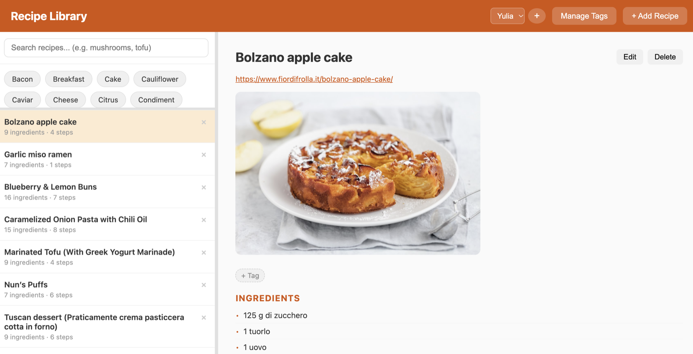
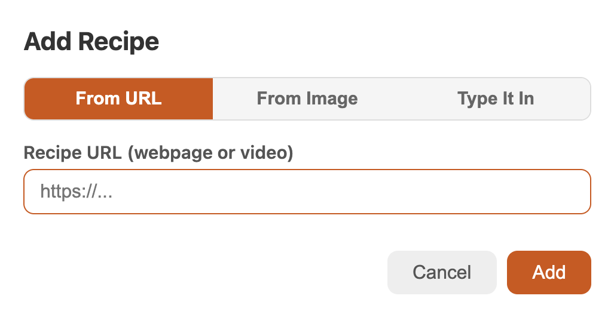
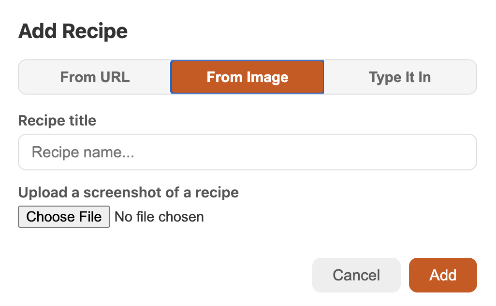
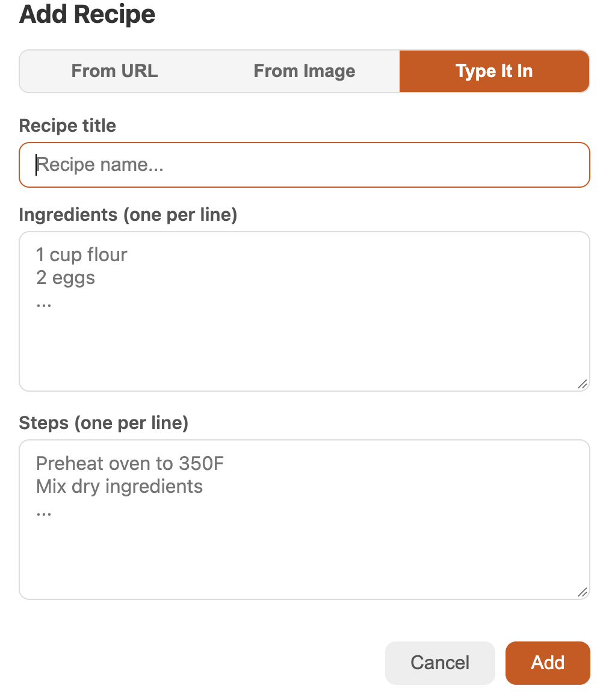
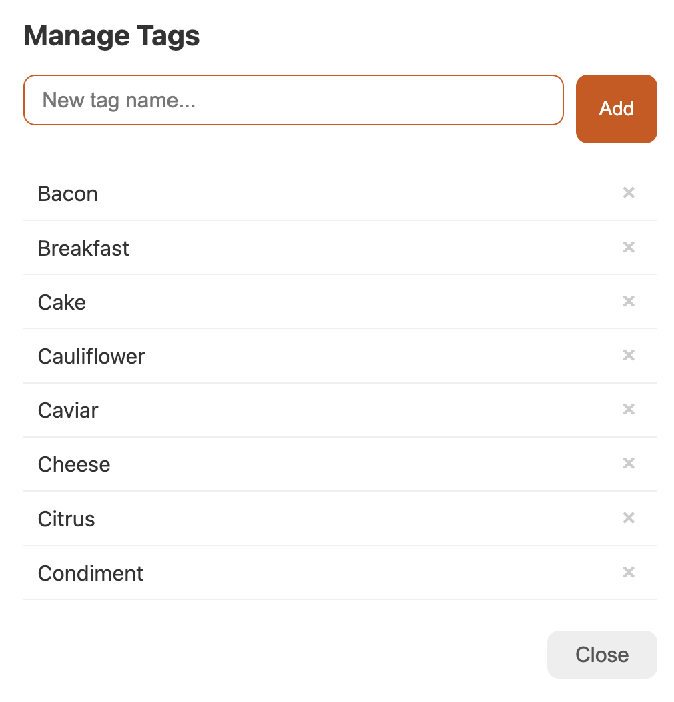

# Recipe Library

A personal recipe library that can pull recipes in from websites, cooking videos and screenshots. It's a Flask app with a JSON API, and it stores everything in a local SQLite database (`recipes.db`).



Your recipes are listed on the left, under the search box and a row of tag buttons. Click a recipe to see its source link, photo, tags, ingredients and steps on the right, where you can also **Edit** or **Delete** it.

## Adding recipes

Click **+ Add Recipe** and choose one of three ways to add a recipe.

### From a link

Paste a link to either:

- **a recipe webpage**, such as a food blog or recipe site, or
- **a recipe video** on YouTube, Instagram, TikTok or a similar site.

The app pulls out the title, ingredients, steps and photo for you. For videos, it reads the video's description and captions, and if those don't contain the recipe, it transcribes the audio. If a video site needs you to sign in, the app asks for a username and password and remembers them for that site.



### From a screenshot

Give the recipe a title and upload a screenshot or photo of it. The app reads the text in the image (OCR) and splits it into ingredients and steps.



### Manually

Type in the title, then the ingredients and steps, one per line.



You can fix anything the app got wrong with **Edit** after the recipe is saved.

## Tags

Tags help you organize recipes by things like type of dish, diet or main ingredient. The app starts with **Vegan**, **Vegetarian**, **Dessert** and **Meal**, and you can add as many of your own as you like.

- **Manage your tags:** click **Manage Tags** to create new tags or delete ones you no longer need.
- **Tag a recipe:** open the recipe and click **+ Tag** to choose a tag. Type a new name in the picker to create a tag on the spot.



## Searching and filtering

- **By tag:** click a tag button above the recipe list to show only recipes with that tag. Click it again to show all recipes.
- **By ingredient (or title or tag):** type in the search box. For example, `mushrooms` finds every recipe that uses mushrooms. Separate words with commas to find recipes that match all of them: `mushrooms, tofu` shows only recipes with both.

## Other features

- **Multiple users:** each recipe belongs to a user. Use the menu at the top to switch between users' libraries, or **+** to add a user. The app remembers the selected user in your browser.

## How recipe extraction works

The logic is in `extractor.py`.

- **Webpages:** first looks for structured recipe data (schema.org JSON-LD) in the page. If there isn't any, it falls back to parsing the HTML. Pages are fetched with `curl_cffi` impersonating Chrome when it's installed, which gets past some bot blocking.
- **Videos:** uses `yt-dlp` to read the video's title, description and subtitles without downloading the video, and follows recipe links in the description. If that isn't enough, it transcribes the audio with OpenAI's Whisper (`openai/whisper-base` via Hugging Face `transformers`). Whisper loads the first time it's needed, which can be slow.
- **Images:** cleans up the image (grayscale, higher contrast, sharpened) and runs Tesseract OCR on it. It then splits the text into ingredients and steps.

## Running it

Requires Python 3. Image upload also needs the [Tesseract](https://github.com/tesseract-ocr/tesseract) OCR engine (`brew install tesseract` on macOS).

```bash
python -m venv venv
source venv/bin/activate
pip install -r requirements.txt
cp recipes_template.db recipes.db   # first time only: create your own database from the template
python app.py
```

Then open http://localhost:5003.

### The database

The repo ships an empty starter database, `recipes_template.db`. It has all the tables and the default tags but no recipes or users. **Before running the app for the first time, rename (or copy) it to `recipes.db`.** The app reads and writes `recipes.db`, which is where your recipes will live.

`recipes.db` is listed in `.gitignore`, so your personal recipes (and any saved logins) stay on your computer and are never committed. Keep `recipes_template.db` unchanged so it stays a clean starting point.

## API

| Method | Endpoint | Description |
|---|---|---|
| `GET` | `/api/recipes` | List recipes (optional `?tag=` and `?user_id=` filters) |
| `GET` | `/api/recipes/<id>` | Get one recipe |
| `POST` | `/api/recipes` | Add from a `url`, or manually with `title`, `ingredients` and `steps` |
| `POST` | `/api/recipes/from-image` | Add from an uploaded image (`image` form field) |
| `PATCH` | `/api/recipes/<id>` | Update `title`, `ingredients` or `steps` |
| `DELETE` | `/api/recipes/<id>` | Delete a recipe |
| `GET` / `POST` | `/api/tags` | List or create tags |
| `DELETE` | `/api/tags/<id>` | Delete a tag |
| `POST` | `/api/recipes/<id>/tags` | Add a tag to a recipe (`tag_id`) |
| `DELETE` | `/api/recipes/<id>/tags/<tag_id>` | Remove a tag from a recipe |
| `GET` / `POST` | `/api/users` | List or create users |
| `DELETE` | `/api/users/<id>` | Delete a user and their recipes |
| `GET` | `/api/credentials` | List saved logins (site and username only) |
| `DELETE` | `/api/credentials/<domain>` | Delete a saved login |

## Files

| File | Purpose |
|---|---|
| `app.py` | Flask app, database setup and API on port 5003 |
| `extractor.py` | Gets recipes out of webpages, videos and images |
| `templates/index.html` | The UI: HTML, CSS and JavaScript |
| `recipes_template.db` | Empty starter database; copy it to `recipes.db` before first run |
| `recipes.db` | Your local SQLite database with recipes, tags, users and saved logins (not committed) |
| `requirements.txt` | Python dependencies |
| `assets/` | Screenshots used in this README |

> **Note:** saved logins are stored as plain text in `recipes.db`. That's one reason the file is git-ignored. Don't force-add it to the repo.
